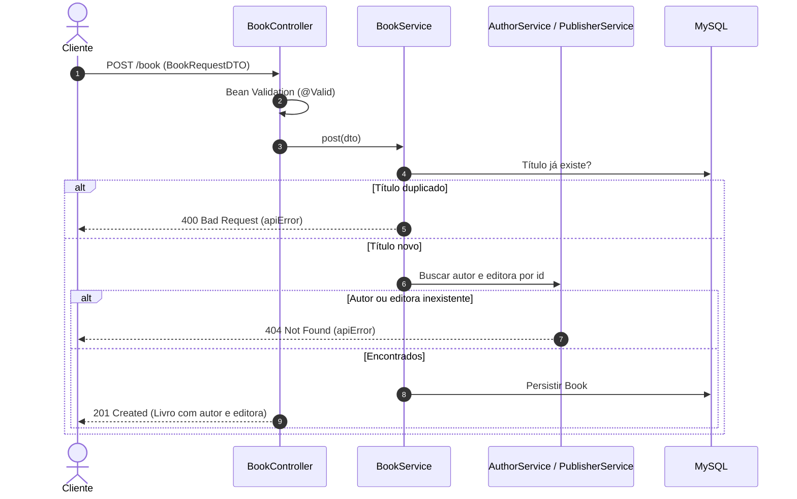

# 📚 Books API — Catálogo Literário


> Cadastro de livros, autores e editoras com relacionamentos, validação e respostas de erro padronizadas.

A **Books API** é uma API RESTful desenvolvida em **Java 17** e **Spring Boot** para gerenciar um catálogo literário. Ela modela três entidades — **Livro** (`Book`), **Autor** (`Author`) e **Editora** (`Publisher`) — e relaciona cada livro ao seu autor e à sua editora. A API valida os dados de entrada, impede duplicidade de títulos e nomes e devolve erros num formato JSON único.



---

## ✨ O Problema
Catálogos de bibliotecas e livrarias costumam sofrer com:
- **Dados inconsistentes**: Livros cadastrados sem autor, sem editora ou com informações incompletas.
- **Duplicidade**: O mesmo título, autor ou editora cadastrado mais de uma vez.
- **Erros pouco claros**: Respostas de erro diferentes em cada rota, difíceis de tratar no cliente.

---

## 🚀 A Solução
- **Relacionamentos explícitos**: Cada livro referencia um autor e uma editora existentes (`authorId` e `publisherId`).
- **Validação na entrada**: Campos obrigatórios e limites de tamanho validados com Bean Validation.
- **Unicidade**: Títulos de livros e nomes de autores e editoras não se repetem.
- **Erros padronizados**: Um `@ControllerAdvice` converte exceções em respostas com `message`, `status` e `timestamp`.

---

## 🎯 Diferenciais
- **DTOs separados para entrada e saída**: `BookRequestDTO` recebe ids; `BookResponseDTO` devolve o autor e a editora completos.
- **Mapeamento com MapStruct**: Conversão entre entidades e DTOs gerada em tempo de compilação.
- **Camada de serviço**: Regras de negócio fora dos controllers.

---

## 🛠️ Stack Tecnológica

| Camada | Tecnologia |
|---|---|
| **Linguagem** | Java 17 |
| **Framework** | Spring Boot 2.7.4 (Web, Data JPA, Validation, DevTools) |
| **Banco de Dados** | MySQL |
| **Mapeamento Objeto-Objeto** | MapStruct 1.5.3 |
| **Boilerplate Reduction** | Project Lombok |
| **Build** | Maven (wrapper incluso) |

---

## 🏛️ Arquitetura

O projeto segue uma arquitetura em camadas:

```
controller   ← Endpoints REST (BookController, AuthorController, PublisherController)
   ↓
service      ← Regras de negócio, unicidade e busca de relacionamentos
   ↓
repository   ← Interfaces Spring Data JPA
   ↓
model        ← Entidades JPA (Book, Author, Publisher)
```

### Principais Entidades
- **`Book`**: Título, descrição, número de páginas e capítulos; pertence a um `Author` e a um `Publisher`.
- **`Author`**: Nome e idade; possui vários livros.
- **`Publisher`**: Nome único; possui vários livros.

---

## 📁 Estrutura do Projeto

```text
books-api/
├── pom.xml
├── mvnw / mvnw.cmd
└── src/main/
    ├── java/br/com/LibraryAPI/
    │   ├── controller/          # Endpoints REST
    │   ├── dto/                 # DTOs de entrada e saída
    │   ├── exception/           # Exceções de domínio e handler global
    │   ├── mapper/              # Mappers MapStruct
    │   ├── model/               # Entidades JPA
    │   ├── repository/          # Repositórios Spring Data
    │   └── service/             # Regras de negócio
    └── resources/
        └── application.properties
```

---

## ⚡ Quick Start

### Pré-requisitos
- [JDK 17](https://adoptium.net/) instalado
- MySQL em execução na porta `3306`

### 1. Clonar o repositório
```bash
git clone https://github.com/matheusnascimentods/books-api.git
cd books-api
```

### 2. Criar o banco de dados
```sql
CREATE DATABASE library;
```
As tabelas são criadas automaticamente pelo Hibernate (`ddl-auto=update`).

### 3. Executar a Aplicação
```bash
./mvnw spring-boot:run
```

A API estará disponível em: **`http://localhost:8080`**

---

## 💻 Comandos Úteis de Desenvolvimento

```bash
# Compilar o projeto e processar anotações (Lombok + MapStruct)
./mvnw clean compile

# Rodar os testes
./mvnw test

# Empacotar o JAR e executá-lo
./mvnw clean package
java -jar target/LibraryAPI-0.0.1-SNAPSHOT.jar
```

---

## 🔌 API Reference

### 📖 Livros (`/book`)
| Método | Rota | Descrição |
| :--- | :--- | :--- |
| `GET` | `/book` | Lista todos os livros |
| `GET` | `/book/{id}` | Busca um livro pelo id |
| `POST` | `/book` | Cadastra um livro |
| `PUT` | `/book/{id}` | Atualiza um livro |
| `DELETE` | `/book/{id}` | Remove um livro |

Corpo de `POST` e `PUT`:
```json
{
  "title": "Dom Casmurro",
  "description": "Romance de Machado de Assis",
  "pages": 256,
  "chapters": 148,
  "authorId": 1,
  "publisherId": 1
}
```
`title` (até 225 caracteres) e `description` (até 550) são obrigatórios; `pages` e `chapters` aceitam no máximo 3000.

### ✍️ Autores (`/author`)
| Método | Rota | Descrição |
| :--- | :--- | :--- |
| `GET` | `/author` | Lista todos os autores |
| `GET` | `/author/{id}` | Busca um autor pelo id |
| `POST` | `/author` | Cadastra um autor |
| `DELETE` | `/author/{id}` | Remove um autor |

```json
{ "name": "Machado de Assis", "age": 69 }
```

### 🏢 Editoras (`/publisher`)
| Método | Rota | Descrição |
| :--- | :--- | :--- |
| `GET` | `/publisher` | Lista todas as editoras |
| `GET` | `/publisher/{id}` | Busca uma editora pelo id |
| `POST` | `/publisher` | Cadastra uma editora |
| `DELETE` | `/publisher/{id}` | Remove uma editora |

```json
{ "name": "Companhia das Letras" }
```

### ⚠️ Respostas de erro
| Status | Quando |
| :--- | :--- |
| `400` | Dados inválidos ou título/nome já cadastrado |
| `404` | Livro, autor ou editora não encontrado |

```json
{
  "message": "Não existe nenhum livro com o id 10",
  "status": 404,
  "timestamp": "10-11-2026 10:30:00"
}
```

---

## 🗂️ Configuração

As configurações ficam em [`application.properties`](src/main/resources/application.properties):

| Propriedade | Descrição | Valor Default (Local) |
| :--- | :--- | :--- |
| `spring.datasource.url` | URL JDBC do MySQL | `jdbc:mysql://localhost:3306/library` |
| `spring.datasource.username` | Usuário do banco | `root` |
| `spring.datasource.password` | Senha do banco | `root` |
| `spring.jpa.hibernate.ddl-auto` | Estratégia de criação do schema | `update` |

Pelo relaxed binding do Spring Boot, qualquer propriedade pode ser sobrescrita por variável de ambiente (ex.: `SPRING_DATASOURCE_PASSWORD`).

---

## 🔒 Segurança & Boas Práticas

- **Validação de entrada**: Todas as escritas passam por Bean Validation antes de chegar ao serviço.
- **Sem autenticação**: A API não possui autenticação; é um projeto de estudo e não deve ser exposta publicamente sem uma camada de segurança.
- **Credenciais locais**: Os valores `root`/`root` servem apenas para desenvolvimento; use variáveis de ambiente em qualquer outro ambiente.

---

## 🤝 Contribuindo

1. Faça um Fork do projeto
2. Crie uma branch para a sua funcionalidade (`git checkout -b feature/nome-da-feature`)
3. Faça o commit das suas alterações (`git commit -m 'feat: implementa nova funcionalidade'`)
4. Envie para o repositório remoto (`git push origin feature/nome-da-feature`)
5. Abra um **Pull Request** detalhando as alterações

---

## 📄 Licença

Distribuído sob a licença MIT. Veja [`LICENSE.txt`](LICENSE.txt) para mais detalhes.

---
Feito com ❤️ por [@matheusnascimentods](https://github.com/matheusnascimentods)
